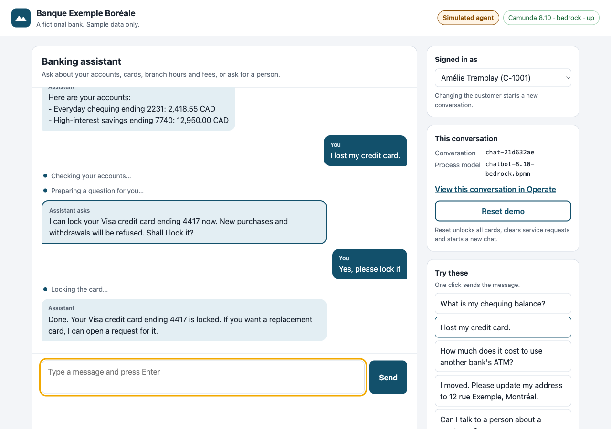
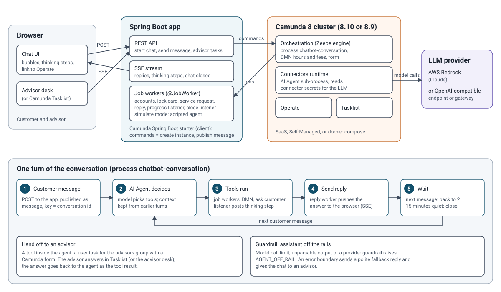
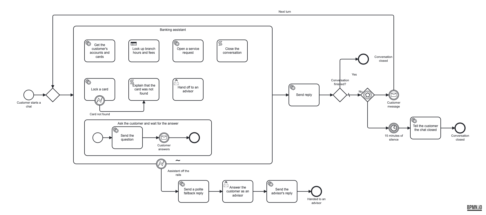
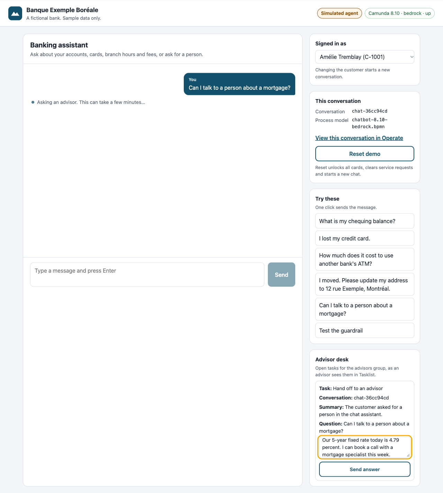
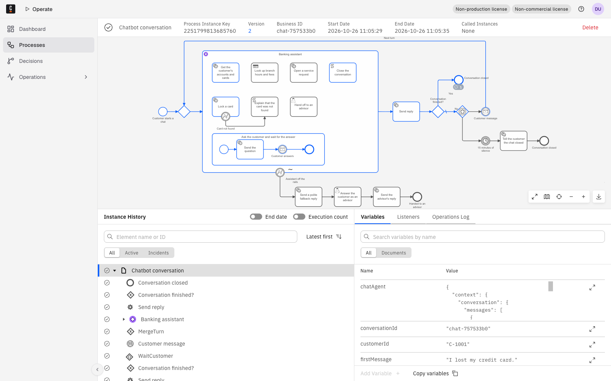
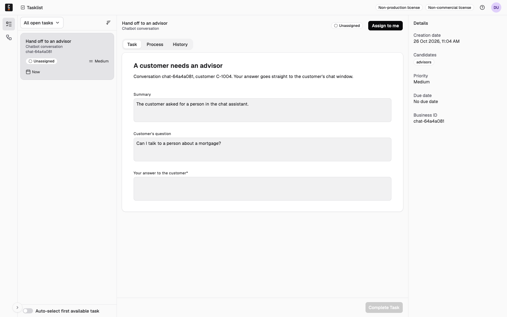

# Banking Spring Chatbot for Camunda 8

[](https://github.com/camunda-community-hub/community)
[](https://github.com/Camunda-Community-Hub/community/blob/main/extension-lifecycle.md#proof-of-concept-)


A banking chatbot written in Spring Boot where every conversation is a Camunda 8 process, an AI agent picks the tools, and your own Java job workers do the work.

Created and maintained by Zishan Ali Khan ([@zishan-c8academy](https://github.com/zishan-c8academy)), Solutions Engineer at Camunda.



The bank, customers, accounts and fees are fictional. The screenshot comes from simulate mode on a local Camunda 8.10.6.

## What it shows

- **The Camunda 8 way in Spring code.** The engine runs outside the app. The app uses the Camunda Spring Boot starter, starts process instances, publishes messages and answers jobs with `@JobWorker` methods. Each worker has a comment that maps it to the JavaDelegate it replaces.
- **An AI agent that stays inside your process.** The AI Agent sub-process decides which tools to call. The tools are BPMN activities: Java workers, a DMN table, a sub-flow that asks the customer, and a user task for an advisor. Business rules live in BPMN, DMN and Java, not in the prompt; for example, the card lock worker refuses to lock a card the customer has not confirmed.
- **A long-running conversation as one process instance.** Message correlation on the conversation id continues the chat, the agent keeps its context across turns, and a 15-minute timer closes quiet chats.
- **Guardrails and people in the loop.** When the agent goes off the rails (model call limit, unparsable output), an error boundary sends a polite reply and gives the chat to an advisor in Tasklist.
- **The process owns its LLM settings.** The model, region and endpoint live in a cluster variable and the credentials in Camunda secrets. The app starts a conversation with business data only and never sees the model or the key.
- **One source, two Camunda versions, three ways to reach the LLM.** A small generator writes the same process for Camunda 8.10 (AI Agent Sub-process v2) and 8.9, for AWS Bedrock, any OpenAI-compatible endpoint, or (8.10) an LLM gateway that is already set up on the cluster. Each variant is one folder you can deploy as is.

## Architecture



Mermaid source: [docs/architecture.mmd](docs/architecture.mmd).

### How a message flows

1. The customer types a message. The browser posts it to `POST /api/conversations/{id}/messages`.
2. The app publishes the Camunda message `chatbot.customer-message` with correlation key = conversation id. The waiting process instance takes it.
3. The **Banking assistant** (AI Agent sub-process) sends the message, the system prompt and the conversation so far to the model. The model answers with tool calls.
4. Camunda runs each tool activity. A start execution listener on every tool creates a `chatbot.progress` job; the app turns it into a thinking step such as "Checking your accounts…".
5. The tool results go back to the model, which writes the answer.
6. **Send reply** creates a `chatbot.reply` job. The worker pushes the answer to the browser over server-sent events.
7. The process waits for the next message (back to step 3) or 15 minutes of silence (it closes the chat).



## Try it in five minutes: simulate mode

Simulate mode needs no LLM key and no cloud account. A worker in the app takes the AI agent's jobs and plays scripted agent turns from the demo data, so the real BPMN, the real tool workers, the progress listeners, the user task and the guardrail all run on a real Camunda engine. **Only the model is replaced.** The UI shows a "Simulated agent" badge, and the app logs a warning at startup.

```sh
mkdir -p secrets && for n in CHATBOT_AWS_ACCESS_KEY CHATBOT_AWS_SECRET_KEY CHATBOT_LLM_API_KEY; do
  [ -f "secrets/$n" ] || printf simulate > "secrets/$n"; done      # 8.10 needs the secrets to exist; any value works here
docker compose up -d                                   # Camunda 8.10 on localhost:8080, without connectors
./mvnw spring-boot:run -Dspring-boot.run.profiles=simulate
open http://localhost:8090
```

Click the prompts under "Try these". Open Operate at http://localhost:8080/operate (user `demo`, password `demo`) to watch each conversation as a process instance.

Do not run simulate mode against a cluster that runs the connectors runtime (SaaS, or `docker compose --profile llm`). Both would take the same agent jobs.

## What you need

| You need | For | Notes |
|---|---|---|
| Java 21 | the app | The Maven wrapper (`./mvnw`) downloads Maven. |
| Docker | simulate mode, local Camunda, the test suite | The tests start Camunda in Testcontainers. |
| A Camunda 8.10 or 8.9 cluster | running the process | Camunda SaaS, Self-Managed, or the `docker-compose.yaml` in this repo. |
| Camunda client credentials (SaaS) | the app's connection | In Console: cluster > API > Create client, scope **Zeebe** (Orchestration Cluster API). Keep the client id and secret. |
| An LLM | the real agent (not simulate mode) | Option A: AWS Bedrock. Option B: any OpenAI-compatible endpoint. Details below. |

### Option A: AWS Bedrock

| Item | Value |
|---|---|
| IAM user or role | Allowed `bedrock:InvokeModel` and `bedrock:InvokeModelWithResponseStream` on the Claude model (and on the inference profile, if you use one) in your region. |
| Model access | Enable the Claude model in the Bedrock console for that region. |
| Model id | The model or inference profile id from the Bedrock console, for example `us.anthropic.claude-sonnet-4-5-20250929-v1:0`. Use the Sonnet version your account has. |
| Region | For example `us-east-1` or `ca-central-1`. A cross-region inference profile (`us.` or `global.` prefix) can process requests outside the region you call; check this against your data residency rules. |
| Camunda secrets | `CHATBOT_AWS_ACCESS_KEY`, `CHATBOT_AWS_SECRET_KEY` |
| Cluster variable `CHATBOT_LLM` | `{"model": "us.anthropic.claude-sonnet-4-5-20250929-v1:0", "region": "us-east-1"}` |
| App env var | `CHATBOT_LLM_PROVIDER=bedrock` (the default) |

### Option B: OpenAI-compatible endpoint

| Item | Value |
|---|---|
| Base URL | The endpoint that serves `/chat/completions`, ending in `/v1` or the gateway's equivalent. Examples: `https://api.openai.com/v1`, an Azure OpenAI or internal LLM gateway URL that speaks the OpenAI chat completions API, `https://openrouter.ai/api/v1`. |
| Model | The model name the endpoint expects, for example `anthropic/claude-sonnet-5` on OpenRouter. |
| Camunda secret | `CHATBOT_LLM_API_KEY` (sent as a bearer token) |
| Cluster variable `CHATBOT_LLM` | `{"model": "anthropic/claude-sonnet-5", "endpoint": "https://openrouter.ai/api/v1"}` |
| App env var | `CHATBOT_LLM_PROVIDER=openai` |

The model must support tool calling. The 8.10 connector calls the endpoint with streaming on.

### Option C: an LLM gateway already set up on the cluster (8.10)

For teams that run an internal OpenAI-compatible gateway and have configured it once on the cluster, as a cluster variable and a secret that other agents use too. The model in `8.10-gateway/` reads the endpoint and model from that existing cluster variable instead of `CHATBOT_LLM`, and the key from that secret.

| Item | In this sample |
|---|---|
| Cluster variable (FEEL) | `camunda.vars.env.GENAI_GATEWAY.endpoint` and `.model` |
| Secret | `GENAI_GATEWAY_KEY`, read as `=camunda.secrets.GENAI_GATEWAY_KEY` |
| App env vars | `CHATBOT_LLM_PROVIDER=gateway`, `CHATBOT_TARGET=8.10` |

A shared cluster also needs names that cannot collide, so this variant uses its own: process `BankingChatbot_Conversation`, job types `banking-chatbot.*`, message `banking-chatbot.customer-message`, DMN `BankingChatbot_BranchFees`, form `BankingChatbot_AdvisorReply`. The app switches to them when `CHATBOT_LLM_PROVIDER=gateway`; the same `@JobWorker` code serves them through the starter's worker overrides. To use your own variable, secret or names, change `GATEWAY_VARIABLE`, `GATEWAY_SECRET` and `GATEWAY` in `tools/generate_models.py`, regenerate, and set the `camunda.chatbot.*` names below to match (`camunda.chatbot.llm-variable` for the variable).

To put this variant into Camunda Hub, upload the `8.10-gateway/` folder to a project and deploy it with "All resources".

### Where each setting goes

Three places, read by three different parts. Mixing them up is the most common setup mistake.

| Setting | Where you set it | Read by |
|---|---|---|
| LLM credentials: `CHATBOT_AWS_ACCESS_KEY` and `CHATBOT_AWS_SECRET_KEY`, or `CHATBOT_LLM_API_KEY` | Camunda secrets. SaaS: Console > your cluster > **Cluster secrets** | The AI Agent connector, when it calls the model |
| LLM settings: the cluster variable `CHATBOT_LLM` with `model` plus `region` (Bedrock) or `endpoint` (OpenAI-compatible) | Cluster variables. SaaS: open **Admin** on your cluster > **Cluster variables** > **Create variable** | The process model, when the engine creates the agent's job |
| Connection: `SPRING_PROFILES_ACTIVE=saas`, `CAMUNDA_CLUSTER_ID`, `CAMUNDA_CLUSTER_REGION`, `CAMUNDA_CLIENT_ID`, `CAMUNDA_CLIENT_SECRET` | Environment of the Spring app | The app, to connect to your cluster |
| Which model to deploy: `CHATBOT_TARGET`, `CHATBOT_LLM_PROVIDER` | Environment of the Spring app | The app, to pick the folder it deploys at startup |

The app never reads the model, the endpoint or a key. It starts a process instance with the customer's message. When the instance reaches the agent, the engine evaluates `=camunda.vars.env.CHATBOT_LLM.model` (and `.region` or `.endpoint`) and the secret reference, and the connector calls the model. Nothing has to "detect" the cluster: the variable and the secrets live on the cluster that runs the process.

### The `CHATBOT_LLM` cluster variable

Create it once per cluster, as JSON (the default kind):

```json
{"model": "us.anthropic.claude-sonnet-4-5-20250929-v1:0", "region": "us-east-1"}
```

for Bedrock, or for an OpenAI-compatible endpoint:

```json
{"model": "anthropic/claude-sonnet-5", "endpoint": "https://openrouter.ai/api/v1"}
```

- **SaaS**: open Admin on your cluster, tab **Cluster variables**, **Create variable**, name `CHATBOT_LLM`, paste the JSON.
- **docker compose or any cluster with an unprotected API**:
  ```sh
  curl -X POST localhost:8080/v2/cluster-variables/global -H 'Content-Type: application/json' \
    -d '{"name":"CHATBOT_LLM","value":{"model":"anthropic/claude-sonnet-5","endpoint":"https://openrouter.ai/api/v1"}}'
  ```
- **Self-Managed with authentication**: Admin, or the same API call with a token.

Cluster variables exist from Camunda 8.9, so the 8.9 and 8.10 models both use this. Change the model by editing the variable: new agent calls pick it up, with no redeploy and no app restart. Do not put keys in it; cluster variables are not secrets.

### Where the secrets go

LLM credentials never reach the Spring app. They are Camunda secrets, and the two model versions refer to them differently:

- **8.10 models**: `=camunda.secrets.NAME`. The cluster resolves the secret before the agent's job is created; the value never appears in job variables.
- **8.9 models**: `{{secrets.NAME}}`, resolved by the connectors runtime.

| Secret name | Used by |
|---|---|
| `CHATBOT_AWS_ACCESS_KEY` | Bedrock |
| `CHATBOT_AWS_SECRET_KEY` | Bedrock |
| `CHATBOT_LLM_API_KEY` | OpenAI-compatible |

- **SaaS**: create them under the cluster's secrets in Console. Nothing else to configure.
- **docker compose, 8.10 models**: put each value in a file under `./secrets/` named after the secret, for example `secrets/CHATBOT_LLM_API_KEY` containing only the key. The folder is git-ignored and mounted into Camunda as its secret store. On Linux the files must be readable by the container user (UID 1001).
- **docker compose, 8.9 models**: export the variable before `docker compose --profile llm up -d`; the compose file passes it to the connectors container as `CONNECTORS_SECRET_<NAME>`.
- **Self-Managed (Helm)**: configure a secret store for the orchestration cluster (8.10) or environment variables on the connectors deployment (8.9), following your platform's secret handling.

## Run with a real LLM

### Choose the Camunda version and the provider

| Env var | Values | Default |
|---|---|---|
| `CHATBOT_TARGET` | `8.10` (AI Agent Sub-process v2) or `8.9` | `8.10` |
| `CHATBOT_LLM_PROVIDER` | `bedrock`, `openai` or `gateway` (8.10 only) | `bedrock` |
| `CHATBOT_DEPLOY_ON_START` | deploy the variant folder at startup | `true` |
| `CHATBOT_OPERATE_URL` | Operate link, `{key}` is replaced by the process instance key | local Operate, or your SaaS Operate with the `saas` profile |

These are the only chatbot settings the app has. The model, region and endpoint are in the `CHATBOT_LLM` cluster variable, not here.

At startup the app deploys the folder `src/main/resources/bpmn/<target>-<provider>/`: the BPMN with its DMN and form. `CHATBOT_TARGET` and `CHATBOT_LLM_PROVIDER` only choose that folder, so they must match the model you want to run. If you deploy from Hub instead, set `CHATBOT_DEPLOY_ON_START=false`. Otherwise the app deploys its own variant on top of yours as a newer version, and new chats start that version: with the default provider, the Bedrock model.

Names the app uses, in case you change them in the generator: `camunda.chatbot.process-id`, `message-name`, `job-type-prefix` and `llm-variable`. The defaults match the generic models; `gateway` mode switches them to the prefixed names.

### Camunda SaaS (8.10 or 8.9)

On the cluster, once:

1. **Cluster secrets** (Console > your cluster): `CHATBOT_LLM_API_KEY` for OpenAI-compatible, or `CHATBOT_AWS_ACCESS_KEY` and `CHATBOT_AWS_SECRET_KEY` for Bedrock. Only these names; the models do not read other secret names.
2. **Cluster variable** `CHATBOT_LLM` (Admin > Cluster variables), see above.
3. **API client** (Console > your cluster > API > Create client, scope Zeebe). Keep the client id and secret.

Then run the app with the `saas` profile:

```sh
export SPRING_PROFILES_ACTIVE=saas                              # without it, the app connects to localhost:8080
export CAMUNDA_CLUSTER_ID=...  CAMUNDA_CLUSTER_REGION=...      # from the client's connection details, for example bru-2
export CAMUNDA_CLIENT_ID=...   CAMUNDA_CLIENT_SECRET=...
export CHATBOT_TARGET=8.10 CHATBOT_LLM_PROVIDER=openai          # or bedrock
export CHATBOT_OPERATE_URL='https://<your Operate address from Console>/processes/{key}'
./mvnw spring-boot:run
```

SaaS runs the connectors runtime for you. If Console shows other API addresses than the pattern in `application-saas.yaml`, set `CAMUNDA_REST_ADDRESS` and `CAMUNDA_GRPC_ADDRESS`. Check `curl localhost:8090/api/health` before you chat: `restAddress` must be your cluster, not `http://localhost:8080`.

To see or change the model in Camunda Hub (8.10) or Web Modeler (8.9): upload **one** folder from `src/main/resources/bpmn/`, the one for your target and provider, for example `8.10-openai/`. It holds the BPMN, the DMN and the form. Do not upload several of these folders into one Hub folder: the four generic variants share the process id `chatbot-conversation`, and "Deploy all resources" then fails with `Duplicated process id 'chatbot-conversation'`. Deploy with **Deploy & run with "All resources"** and set `CHATBOT_DEPLOY_ON_START=false`. The DMN and form are linked with `bindingType="deployment"`, so each process version uses the DMN and form deployed with it, and deploying the BPMN alone fails at those steps. Start chats from the app either way: it sets the variables the process needs.

### Local Camunda with the connectors runtime

```sh
mkdir -p secrets && printf '%s' "<your key>" > secrets/CHATBOT_LLM_API_KEY   # or the two CHATBOT_AWS_* files
docker compose --profile llm up -d                     # Camunda 8.10.6 and connectors 8.10.2
curl -X POST localhost:8080/v2/cluster-variables/global -H 'Content-Type: application/json' \
  -d '{"name":"CHATBOT_LLM","value":{"model":"anthropic/claude-sonnet-5","endpoint":"https://openrouter.ai/api/v1"}}'
CHATBOT_LLM_PROVIDER=openai ./mvnw spring-boot:run
```

The compose setup keeps data in memory, so create the cluster variable again after `docker compose down`.

For Camunda 8.9: `export CHATBOT_LLM_API_KEY=...` (8.9 has no secret store; the connectors container reads it), then `CAMUNDA_VERSION=8.9.26 CAMUNDA_CONNECTORS_VERSION=8.9.17 docker compose --profile llm up -d`, the same `curl`, and `CHATBOT_TARGET=8.9`. An LLM gateway on your machine is reachable from the connectors container as `http://host.docker.internal:<port>`.

Camunda 8 Run should work too (default addresses `localhost:26500` and `localhost:8080`), but this sample was tested with the compose file.

### Verify your setup

1. `curl localhost:8090/api/health` shows `"connection":"up"`, `restAddress` (your cluster, not localhost when you meant SaaS), the deployed `processFolder`, and `"llmClusterVariable":"CHATBOT_LLM: ok"`. The app logs the same check at startup, with the JSON to create when the variable is missing.
2. Open http://localhost:8090 and click "What is my chequing balance?". You should see "Checking your accounts…" and then the balances.
3. Click "View this conversation in Operate". The instance shows the path the conversation took.
4. `node tools/live_test.mjs` runs the five demo conversations against the app and prints each turn with pass or fail checks (Node 18 or later).
5. If the reply never comes, see the table below, then look for an incident on **Banking assistant** in Operate.

| You see | Cause | Fix |
|---|---|---|
| The chat waits forever; the "View in Operate" link starts with `http://localhost:8080`, and the instance key is not in your SaaS cluster. The startup log warns `No Spring profile is active` | The app runs without the `saas` profile, so it connected to and deployed on a Camunda on your machine | Start with the `saas` profile and the connection variables, then check `restAddress` in the health output. `export` works in bash only: in PowerShell use `$env:SPRING_PROFILES_ACTIVE="saas"`, in IntelliJ set the profile and variables in the run configuration, or pass `"-Dspring-boot.run.profiles=saas"` to Maven |
| `llmClusterVariable: CHATBOT_LLM: not found` | No global cluster variable `CHATBOT_LLM` (or you created it a few seconds ago) | Create it in Admin > Cluster variables |
| `CHATBOT_LLM: missing region` or `missing endpoint` | The variable lacks a field the deployed model reads, often because `CHATBOT_LLM_PROVIDER` does not match your model: the default is `bedrock` | Add the field, or set the provider that matches your model |
| Hub: `Duplicated process id 'chatbot-conversation'` | Several variant folders deployed together | Upload and deploy one folder |
| Incident on Banking assistant | A missing secret (exact names above), a model id your account cannot use, or an endpoint without tool calling | Read the incident message in Operate |

## Demo script

Pick **Amélie Tremblay (C-1001)** unless noted. Each line is one click under "Try these".

| # | Say | What happens |
|---|---|---|
| 1 | What is my chequing balance? | Calls the accounts worker, answers from the result. |
| 2 | I lost my credit card. Then: yes | Reads the cards, asks before acting (Ask the customer sub-flow), locks the Visa ending 4417. |
| 3 | How much does it cost to use another bank's ATM? | Calls the hours and fees DMN and quotes it. |
| 4 | I moved. Please update my address… Then: yes | Confirms, opens a service request, returns a reference number. |
| 5 | Can I talk to a person about a mortgage? | Creates a user task for the advisors group. Answer it in the Advisor desk panel or in Tasklist; the answer comes back to the chat. |
| 6 | Test the guardrail (simulate mode only) | The agent throws `AGENT_OFF_RAIL`; the fallback reply appears and an advisor takes over. |

Say "thanks, bye" to close a chat through the agent's Close the conversation tool. **Reset demo** sets every card back to active.



| Operate | Tasklist |
|---|---|
|  |  |

## Project layout

```
src/main/java/com/example/chatbot/
  conversation/   start a chat, publish messages, SSE hub
  workers/        @JobWorker classes (accounts, lock card, service request, reply, progress, closed)
  simulate/       simulated agent (profile simulate)
  bank/           fictional in-memory bank data
  process/        settings and the deployer that picks the BPMN
  web/            REST controllers, health, advisor desk
src/main/resources/
  bpmn/           generated models, one folder per variant (BPMN, DMN, form), for example bpmn/8.10-openai/
  static/         chat UI (HTML, CSS, JS; no build step)
tools/generate_models.py   the one source for all BPMN variants
tools/live_test.mjs        drives the demo conversations against a running app
docs/C7-TO-C8.md           what changed from Camunda 7 and where it shows here
```

## The 8.10 and 8.9 models

The five variant folders come from `tools/generate_models.py`: 8.10 and 8.9, each for Bedrock and OpenAI-compatible, plus the 8.10 gateway variant. Tools, flow, prompts and listeners are identical; only the agent element changes (and, in the gateway variant, the names):

| | Camunda 8.10 | Camunda 8.9 |
|---|---|---|
| Element template | `io.camunda.connectors.agenticai.ai-agent-subprocess.v2`, version 1 | `io.camunda.connectors.agenticai.aiagent.jobworker.v1`, version 8 |
| Job type | `io.camunda.agenticai:aiagent:subprocess:2` | `io.camunda.agenticai:aiagent-job-worker:1` |
| Agent registered for Operate and the Agent Instances API | yes (`zeebe:agentDefinition`) | no |
| OpenAI-compatible provider | `provider.type = openai`, backend `custom` | `provider.type = openaiCompatible` |
| Secret reference | `=camunda.secrets.NAME`, resolved by the cluster | `{{secrets.NAME}}`, resolved by the connectors runtime |

The provider fields are fixed per file because the template's provider type is a fixed choice in Modeler. Region, model and endpoint come from the `CHATBOT_LLM` cluster variable (`GENAI_GATEWAY` in the gateway variant). After you change the generator, run `python3 tools/generate_models.py` and commit the regenerated files; `BpmnModelsTest` fails if the files differ anywhere except the agent element and the gateway variant's names.

## Tests

```sh
./mvnw verify                  # unit tests and process tests on a Camunda 8.9.26 engine (Docker)
./mvnw verify -Pcamunda-8.10   # the same on a Camunda 8.10.6 engine
./mvnw verify -Pcamunda-8.10-client   # build with the 8.10.7 starter and client; tests on an 8.10.7 engine
```

- `ChatbotProcessTest` runs every scenario (balance loop, card lock after confirmation, card not found, fees DMN, service request, advisor handoff, guardrail, timeout) on the four generic models, with the real workers and a scripted agent. It sets `CHATBOT_LLM` on the test engine (`TestLlmSettings`), checks that the agent's job gets the model from it, and checks the app's startup check for a missing or incomplete variable.
- `SimulateModeTest` runs the demo conversations through the simulated agent.
- `ChatApiEndToEndTest` goes through REST and SSE.
- `GatewayVariantProcessTest` runs the gateway variant with its prefixed names.
- The 8.10 models run only on the 8.10 engine, because only 8.10 resolves `=camunda.secrets`. The tests give that engine a file secret store with dummy values (`TestSecrets`). The 8.9 models run on both engines.
- `BpmnModelsTest` parses and validates the models with the Zeebe model API, and checks that each folder holds one BPMN with the DMN and form it links to.

The default build uses the 8.9 client, which works against 8.9 and 8.10 clusters.

Tests use [Camunda Process Test](https://docs.camunda.io/docs/apis-tools/testing/getting-started/) (CPT). Zeebe Process Test has no 8.10 release; CPT replaces it.

## Agent settings and why

The same values are in every model variant (`tools/generate_models.py`).

| Setting | Value | What it means | Why this value |
|---|---|---|---|
| Context window | 30 | How many messages the agent sends to the model. It counts messages, not tokens: about 5 to 7 chat turns with their tool calls and results. | The whole window goes to the model on every call, so a bigger window costs more tokens and time. |
| Memory | in-process | The conversation is kept in the `chatAgent.context` process variable and fed back each turn. | Simple, and visible in Operate. For long or document-heavy conversations, consider Camunda document storage. |
| Max model calls | calls so far + 8 | A budget per turn, because the count runs across the whole conversation. | A normal turn uses 2 to 4 calls. Going over sends the chat to the off-rail path: a polite reply and an advisor. |
| Max completion tokens | 2048 | Upper limit for one answer. | Replies are short; this stops a runaway answer. |
| Model call timeout and retries | 30 seconds, 3 retries, 5 seconds apart | How long one model call may take, and how often the agent job is retried. | A person is waiting. Fail fast and let the advisor path take over. |
| Effort (OpenAI-compatible and gateway) | model default | No reasoning setting is sent to the model. | Faster for a chat. A higher effort adds thinking before every tool call. |
| Response format | text | The answer is plain text, not parsed as JSON. | It goes straight to the chat window. |
| Include agent context | true | The agent's output carries its context. | Needed to keep memory across turns. |
| Include assistant message | false | The raw model message is left out of the output. | Not used; keeps the process variable smaller. |
| Events behavior | wait for tool call results | If an event arrives inside the agent, it waits for running tools instead of cancelling them. | This model has no such events; the default is kept. |

## Design choices

- **Ask the customer** is a small flow inside the tool: send the question, wait for the next message on the same correlation key. The agent can also end its turn with a question; both work. The tool keeps a confirmation inside one agent turn.
- **Thinking steps** use start execution listeners on the tool activities. They work inside the ad-hoc sub-process and need no change to the agent.
- **Closing** is a tool. After each turn a gateway checks the agent's context for a call to Close the conversation. A process-level end listener tells the browser the chat ended, whichever end event was reached.
- **The model call limit** counts calls across the whole conversation, so each turn gets 8 more calls than the conversation has used so far.
- **Errors**: a missing card is a BPMN error caught in the model; a core banking outage is a job error with retries and backoff, then an incident.

## Limits

- If you stop the app while Camunda is handing it a job, that job is offered again only after the job timeout (30 seconds here). A chat started right after a restart can pause that long.
- One app instance: the SSE hub and the demo bank live in memory. With several instances, put a broker between the workers and the browser connections.
- No authentication in the app. The customer picker stands in for a signed-in user.
- The docker compose setup keeps data in memory and has an unprotected API. Use it on a laptop only.
- Simulate mode understands the demo phrases and simple variants, not open conversation.
- The prompts were not tuned against a live model for this sample. Run the demo script against your model and adjust the tool descriptions in the generator if it picks the wrong tool.

## Maintainer and support

Maintainer: Zishan Ali Khan ([@zishan-c8academy](https://github.com/zishan-c8academy)). This is a community extension in the Proof of Concept stage, not a supported Camunda product.

For questions, bugs and ideas, open a GitHub issue in this repo. Include the output of `curl localhost:8090/api/health` and the app's startup log; they show the Camunda address, the deployed model and the cluster variable check.

## Contributing

Pull requests are welcome. See [CONTRIBUTING.md](CONTRIBUTING.md): change the models in `tools/generate_models.py`, not the XML, and run `./mvnw verify -Pcamunda-8.10` before you open the PR. This project follows the [Camunda Community Hub Code of Conduct](https://github.com/camunda-community-hub/community/blob/main/docs/CODE_OF_CONDUCT.MD).

## License

Apache License 2.0. See [LICENSE](LICENSE).
